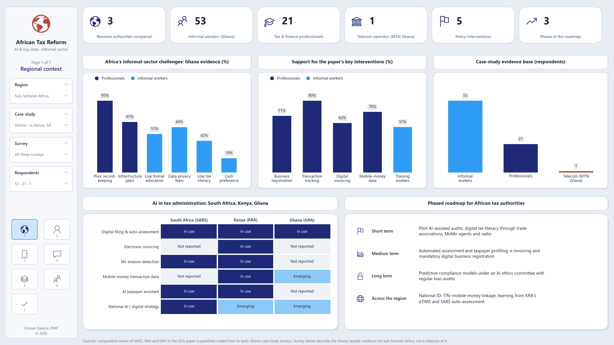
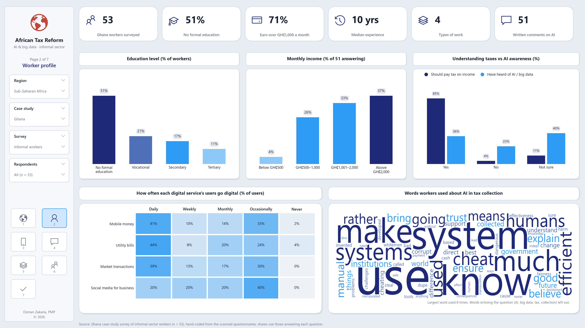
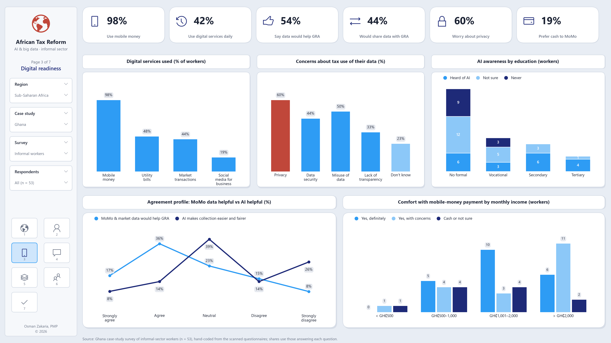
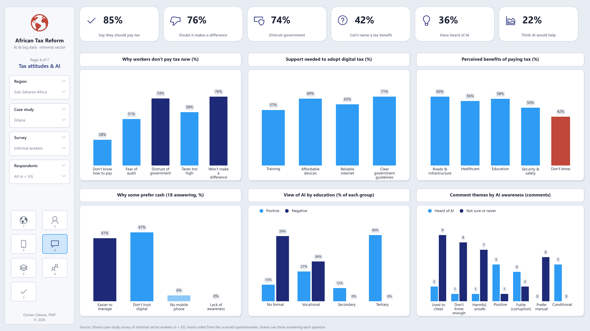
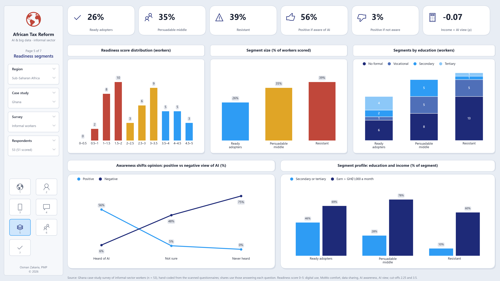
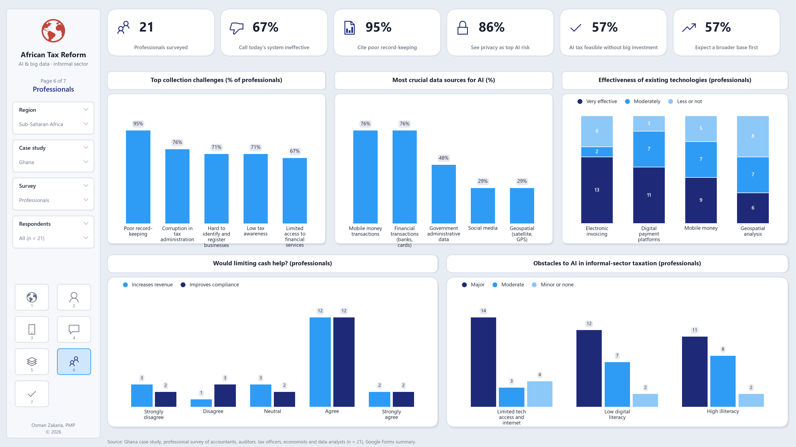
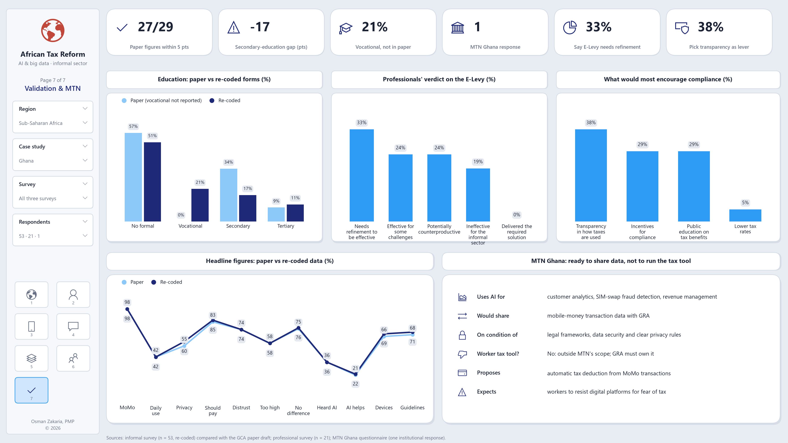

# AI & Big Data for African Tax Reform

**Africa's informal workers already pay digitally. Few yet trust AI to tax them.** This project is the evidence base for *Leveraging Artificial Intelligence and Big Data for African Tax Reform* (GCA paper). The paper asks how AI and big data can widen the tax base in Sub-Saharan Africa's informal sector, with Ghana as the case study and Kenya and South Africa as comparators. The pipeline turns 53 hand-coded informal-sector questionnaires, a survey of 21 tax and finance professionals and MTN Ghana's questionnaire into tested statistics, a check of the paper's figures, and seven report dashboards.

## Findings (Ghana case study)

| | |
|---|---|
| Informal workers surveyed | 53 (artisans, traders, drivers, farmers, service workers) |
| Use mobile money | 98% |
| Say they should pay tax on their income | 85% |
| Of those, doubt paying makes a difference | 34 of 45 |
| Have heard of AI or big data | 36.5% (19 of 52 answering) |
| Think AI would make collection easier and fairer | 22% |
| Professionals calling an AI tax system infeasible | 0 of 21 (43% say only with major investment) |

- **The rails exist; trust doesn't.** Mobile money is near-universal and 79% would accept MoMo for their work, yet 74% cite distrust of government as a reason they don't pay tax. The most common written reaction to AI (11 of 51 comments) is that it would be used to cheat people.
- **Awareness, not income, decides acceptance.** 56% of workers who have heard of AI view it positively, against 3% of the rest (Fisher exact p < 0.001). Education predicts awareness (71% vs 24%), while income has no link to views (Spearman ρ = −0.07).
- **Three readiness segments:** 26% ready adopters, 35% a persuadable middle, 39% resistant. Each needs a different policy, from pilot e-invoicing to an assisted cash channel.
- **Experts agree on transparency.** Professionals pick transparency in how taxes are used as the strongest compliance lever (8 of 21); only 1 picks lower rates.
- **The paper's figures hold up.** 27 of 29 match the coded forms within 5 points. Both exceptions are in education, where the draft has no vocational category (21% of forms).

**Live dashboard:** [AI Tax Reform in Africa: Ghana Case](https://claude.ai/artifact/PoP5JUqWaH6RK664eH1dBY)

## The dashboards

Seven 16:9 pages (PNG at 220 dpi) in `outputs/dashboards/`, also bound together in [`african_tax_reform_dashboards.pdf`](outputs/dashboards/african_tax_reform_dashboards.pdf).

### 1 · Regional context
Africa's informal-sector challenges and the paper's interventions, with Ghana evidence; SARS / KRA / GRA capability grid; phased roadmap.



### 2 · Worker profile
Education, income, understanding taxes vs AI awareness, how often each digital service is used, and a word cloud of the comments.



### 3 · Digital readiness
Services used, data concerns, AI awareness by education, agreement profiles, MoMo comfort by income.



### 4 · Tax attitudes & AI
Barriers, support needed, perceived benefits, reasons for cash, view of AI by education, comment themes.



### 5 · Readiness segments
Score distribution, segment sizes and profiles, and how awareness shifts opinion.



### 6 · Professionals
Collection challenges, data sources, technology ratings, cash policy, obstacles.



### 7 · Validation & MTN
Paper vs coded figures, E-Levy verdict, compliance levers, MTN Ghana's position.



## Run it

```bash
python -m pip install -r requirements.txt
python run_all.py
```

It takes about ten seconds and rebuilds everything in `outputs/`. Use `--dashboards` to redraw the pages from `outputs/results.json` only. The icons use the Segoe MDL2 Assets font, which ships with Windows.

## Method

1. **Coding.** Each informal-sector questionnaire (4 scanned pages) was coded by hand into one row of `data/raw/coded_informal_survey.csv`; ticks and circles both count. Multi-select answers are stored as letter strings (`abd`).
2. **Validation.** Every answer is checked against the codebook in `atr/config.py` before anything is counted; a stray code stops the run.
3. **Shares.** The base is everyone who answered that question; blanks are never counted as "no". Every informal-sector share carries a 95% Wilson interval.
4. **Associations.** Spearman rank correlations, a Kruskal–Wallis test across awareness groups, and Fisher exact tests on 2×2 tables.
5. **Readiness score (0–5).** One point each for weekly or daily digital use, comfort with MoMo payment, willingness to share data, awareness of AI and a positive view of AI, with partial credit for qualified answers. Cut-offs at 2.25 and 3.5 give the three segments.
6. **Comments.** All 51 written answers carry exactly one analyst-assigned theme; the run checks that none is missed. The word cloud leaves out words that echo the question (AI, big data, tax, collection).
7. **Paper check.** Each figure the paper reports is recomputed from the forms and flagged when it differs by 5 points or more.

All codes, weights, cut-offs, themes and paper figures are in `atr/config.py`.

## Code

| File | What it does |
|---|---|
| `atr/config.py` | Paths, codebook, paper figures, readiness weights, comment themes, regional comparison |
| `atr/survey.py` | Loads the coded questionnaires and validates every answer |
| `atr/analysis.py` | Frequencies and intervals, paper check, cross-tabs, tests, readiness segments, comment themes and words |
| `atr/report.py` | The seven report dashboards |
| `atr/publish.py` | CSV tables (`outputs/tables/`) and the live dashboard's data (`outputs/live/`) |
| `dashboard/index.html` | Source of the live dashboard page |
| `run_all.py` | Runs every stage and writes `outputs/` |

## Data

- `data/raw/coded_informal_survey.csv`: 53 anonymous respondents; occupation, education and income bands only, no names.
- `data/raw/professional_mtn.json`: professional survey counts transcribed from the Google Forms summary (n = 21), and MTN Ghana's ticked answers.

Two workers can't be scored for readiness: respondent 6's last page was never scanned, and respondent 16 left the attitude questions blank. Both still count in every chart that uses the questions they answered.

## Limits

- **One country, small sample.** 53 workers from a convenience sample in Ghana are evidence for Sub-Saharan Africa, not a measure of it; most shares carry intervals of ±10–13 points.
- **Self-reported.** Answers about tax may lean towards what respondents think is expected.
- **Associations are not causes.** Education, awareness and attitudes move together.
- **Judgement calls.** The readiness score is a transparent heuristic, not a validated scale; comment themes are single-coded; the SARS / KRA / GRA grid is coded from the paper's own review, where "Not reported" means the paper doesn't mention a capability.

## Analysis and design by Osman Zakaria, PMP · © 2026 Osman Zakaria, PMP ## 
